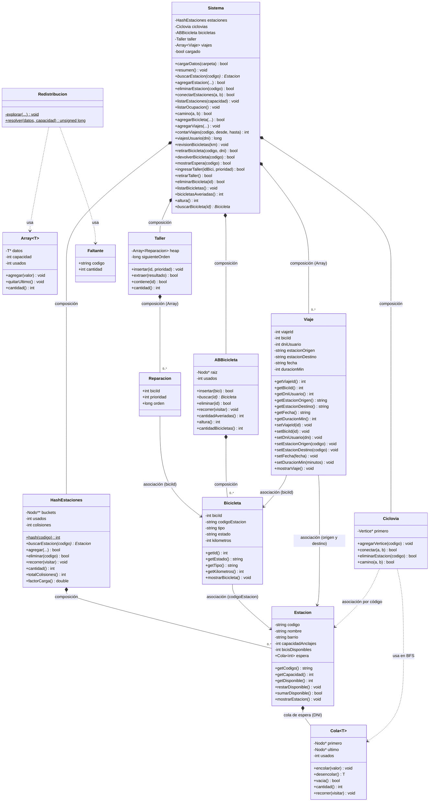

# TP Integrador — Sistema de Bicicletas Públicas

Sistema en C++17 que gestiona la red de bicicletas públicas de Buenos Aires: estaciones, bicicletas, viajes, ciclovías y redistribución de bicicletas. Todas las estructuras de datos (tabla de hash, arreglo dinámico, cola, min-heap, árbol binario de búsqueda y grafo) están implementadas a mano, sin `vector`, `map`, `queue`, `set` ni `priority_queue` de la STL.

## Compilación y ejecución

Desde la carpeta `TP - Integrador/`:

```bash
make          # compila y genera ./bicis
./bicis
```

O sin `make`:

```bash
g++ -std=c++17 -Wall -Wextra -Iinclude src/*.cpp -o bicis
./bicis
```

El programa compila sin warnings con esos flags. Hay que ejecutarlo desde `TP - Integrador/`, porque la opción 1 lee los archivos de `data/` con ruta relativa.

En VS Code o Cursor, `Cmd+Shift+B` (`Ctrl+Shift+B` en Windows/Linux) ejecuta la tarea "Compilar TP Integrador", que genera `src/output/main`. En `COMPILAR.md` hay alternativas con CMake y scripts para Windows.

### Memoria

Se verificó con `leaks --atExit` (macOS) recorriendo todas las opciones del menú: **0 leaks**. En Linux, el equivalente es:

```bash
valgrind --leak-check=full ./bicis
```

## Estructura del proyecto

```
TP - Integrador/
├── data/                   # estaciones, bicicletas, viajes y ciclovias (.txt)
├── include/
│   ├── Estructuras.h       # Array<T> (arreglo dinámico) y Cola<T> (cola enlazada)
│   ├── Estacion.h          # entidad Estacion + cola de espera
│   ├── Bicicleta.h         # entidad Bicicleta
│   ├── Viaje.h             # entidad Viaje
│   ├── HashEstaciones.h    # tabla de hash de estaciones (módulo A)
│   ├── Ciclovias.h         # grafo de ciclovías + BFS (módulo A)
│   ├── ABBicicleta.h       # árbol binario de búsqueda de bicicletas (módulo C)
│   ├── Taller.h            # min-heap del taller de reparaciones (módulo B)
│   ├── Redistribucion.h    # backtracking del camión (módulo D)
│   └── Sistema.h           # fachada que coordina todos los módulos
├── src/
│   ├── main.cpp            # menú por consola
│   └── Sistema.cpp         # implementación de Sistema
└── Makefile
```

## Menú

| Opción | Funcionalidad |
| --- | --- |
| 1 | Cargar datos desde `data/` |
| 2 | Resumen (estaciones, bicicletas, viajes, bicis en el taller, colisiones, factor de carga) |
| 10 – 16 | Módulo A: buscar, agregar, conectar, eliminar, listar ordenadas, ocupación < 20 %, camino mínimo |
| 20 – 22 | Módulo B: viajes por estación y fechas, viajes por DNI, bicis con más de X km |
| 23, 26, 27 | Módulo B: retirar (o entrar en espera), devolver y ver la cola de espera de una estación |
| 24, 25 | Módulo B: ingresar una bici averiada al taller y atender la más urgente (min-heap) |
| 30 – 34 | Módulo C: buscar bici por ID, listar inorder, averiadas y altura, agregar y eliminar bicicleta |
| 40 | Módulo D: redistribución con backtracking |

Todas las entradas numéricas se validan: si se escribe texto donde va un número, se vuelve a pedir el dato.

## Diagrama de clases UML

También está como imagen en [`UML.png`](UML.png).



**Composición** (rombo lleno): el contenedor crea y destruye a sus partes. Por ejemplo, `HashEstaciones` hace `new Estacion` al agregar y `delete` al eliminar o en su destructor; `ABBicicleta` hace lo mismo con cada `Bicicleta`.

**Asociación** (flecha): las entidades se referencian por clave (`codigoEstacion`, `biciId`), no por puntero, así que ninguna es dueña de la otra. Eliminar una estación no elimina sus bicicletas, tal como permite el enunciado.

## Módulo A — Gestión de estaciones

Las estaciones se indexan en una **tabla de hash con encadenamiento separado**: 11 buckets, y cada uno es una lista enlazada de nodos que apuntan a una `Estacion`.

La función hash recorre el código: `valor = (valor * 31 + letra) % 11`. Multiplicar por 31 (un número primo) hace que el orden de las letras influya, así `ABC` y `CBA` caen en buckets distintos. Usar 11 buckets (también primo) reparte mejor los restos. Cada letra se toma como `unsigned char`: con letras como `Ñ` o con tildes, un `char` común es negativo y el índice quedaría fuera de la tabla.

**Resultados con los datos de prueba** (6 estaciones de `data/estaciones.txt`, visibles con la opción 2):

- **Colisiones:** 1
- **Factor de carga final:** 6 / 11 ≈ **0,55**

Las ciclovías se modelan como un **grafo no dirigido con listas de adyacencia**. El camino con menor cantidad de tramos se calcula con **BFS**: como explora por niveles, la primera vez que llega al destino lo hace por el camino más corto. Cada vértice guarda a su `padre`, y con eso se reconstruye el recorrido.

| Operación | Complejidad | Comentario |
| --- | --- | --- |
| Buscar estación | O(1) promedio, O(n) peor caso | O(1 + α), con α el factor de carga |
| Agregar estación | O(1) promedio | Antes busca para no duplicar |
| Eliminar estación | O(1) promedio en el hash + O(V + E) en el grafo | Se quitan todas sus aristas |
| Listar ordenadas | O(n²) | Inserción directa sobre una copia de punteros, para no desarmar la tabla |
| Ocupación < 20 % | O(n) | Recorre toda la tabla |
| Camino mínimo (BFS) | O(V + E) | V = estaciones, E = ciclovías |

## Módulo B — Viajes y colas de espera

| Punto | Complejidad | Estructura y por qué |
| --- | --- | --- |
| 1. Viajes por estación y fechas | O(v) | `Array<Viaje>`. Los viajes solo se agregan y después se recorren completos, así que un arreglo dinámico alcanza: agregar cuesta O(1) amortizado. Las fechas `AAAAMMDD` se comparan como texto de largo fijo, y ese orden coincide con el cronológico. |
| 2. Viajes por DNI + minutos | O(v) | Mismo `Array<Viaje>`. Un usuario puede tener muchos viajes, así que hay que revisarlos todos de cualquier forma. |
| 3. Bicis con más de X km | O(n) | Recorrido inorder del ABB. El ABB está ordenado por ID, no por kilómetros, así que hay que visitar todas las bicicletas. De paso, salen listadas por ID. |
| 4. Cola de espera por estación | O(1) encolar y desencolar | `Cola<int>` enlazada, con punteros al primero y al último. Respeta el orden de llegada (FIFO): si al retirar no hay bicis, el DNI se encola; al devolver, la bici pasa directo al primero de la cola y las disponibles no cambian. La estación se busca en O(1) promedio en el hash. |
| 5. Taller (min-heap) | O(log n) insertar y extraer | Clase `Taller`, un min-heap sobre `Array<Reparacion>`. Mantiene siempre arriba la bici más urgente (prioridad 1), y cada operación solo recorre una rama del árbol, de altura log n. Las eléctricas entran siempre con prioridad 1, y a igual prioridad sale primero la que entró antes. Solo entran bicis averiadas y sin repetir. |

## Módulo C — Registro de bicicletas (ABB)

Las bicicletas se guardan en un **árbol binario de búsqueda ordenado por `biciId`**.

| Operación | Complejidad |
| --- | --- |
| Insertar / Buscar / Eliminar | O(h): O(log n) si está balanceado, O(n) si está degenerado |
| Listar inorder | O(n) |
| Contar averiadas | O(n) |
| Altura | O(n) |
| Liberar memoria (postorder, en el destructor) | O(n) |

La liberación es postorder porque hay que borrar los dos hijos antes que el nodo padre; si se borrara primero el padre, se perderían los punteros a los hijos.

Además, se implementó **eliminar una bicicleta** (el opcional, opción 34; no se permite si la bici está en el taller) contemplando los tres casos: hoja, un hijo y dos hijos. En el último caso se reemplaza por el sucesor inorder, que es el mínimo del subárbol derecho.

### Pregunta de análisis: ¿qué pasa si las bicicletas se cargan ordenadas por ID?

El árbol **degenera en una lista**: cada bicicleta nueva es mayor que todas las anteriores, así que siempre se inserta como hijo derecho del último nodo. La altura queda en **n − 1**, la máxima posible, y la búsqueda pasa de O(log n) a **O(n)**.

Ejemplo con 5 bicicletas insertadas en orden (501, 502, 503, 504, 505):

```
Cargadas ordenadas (altura 4)      Cargadas en otro orden: 503, 501, 504, 502, 505 (altura 2)

501                                        503
  \                                       /   \
  502                                   501   504
    \                                     \     \
    503                                   502   505
      \
      504
        \
        505
```

Buscar la 505 cuesta **5 comparaciones** en el árbol degenerado y **3** en el otro. Con 1000 bicicletas la diferencia sería de 1000 comparaciones contra unas 10.

Con los datos de prueba pasa exactamente esto: `data/bicicletas.txt` tiene los IDs 501 a 507 en orden, y la opción 32 muestra **altura 6** (n − 1 con n = 7).

## Módulo D — Redistribución con backtracking

El camión tiene capacidad exacta **C** y una lista de estaciones con sus faltantes. Se buscan todos los subconjuntos cuya suma sea exactamente C.

Para cada estación, el backtracking prueba dos ramas: **incluirla** (resta su faltante de lo que queda por cargar) o **no incluirla**. Al llegar al final de la lista, si lo restante es 0, se imprime la solución. Hay **poda**: si lo restante se vuelve negativo, se corta esa rama, porque seguir agregando estaciones no puede arreglarlo (los faltantes no son negativos).

**Complejidad en el peor caso: O(2ⁿ · n)**. Hay 2ⁿ subconjuntos posibles, y cada solución se imprime en O(n). La poda mejora mucho los casos reales, pero no el peor caso: si C es mayor o igual que la suma total, nunca se poda.

Antes de buscar, se valida que C y los faltantes no sean negativos y que no haya códigos repetidos. Con C = 0 la única solución es el subconjunto vacío, que se imprime como `{}`.

Ejemplo del enunciado (C = 10, entrada `PLZ 3, CAB 7, RET 5, CON 2, BOE 5`):

```
{PLZ, CAB}
{PLZ, RET, CON}
{PLZ, CON, BOE}
{RET, BOE}
```
