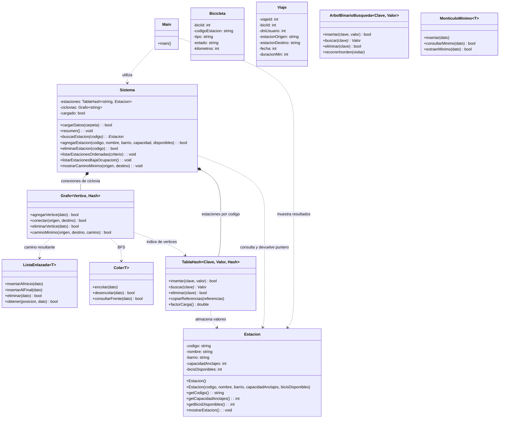

# UML actual — TP Integrador

Este diagrama describe las clases del TP y las estructuras reutilizables existentes al 11/11/2026. Distingue las estructuras ya integradas de las que todavía no usa `Sistema`.

## Lectura del diagrama

- `Main` representa la función libre `main()` de `src/main.cpp`; usa `Sistema` y muestra la estación obtenida.
- `Sistema` contiene una `TablaHash` genérica y guarda las estaciones por código. La tabla administra sus nodos y almacena cada `Estacion` por valor.
- `Sistema` mantiene un grafo genérico con los vértices de las estaciones y las conexiones bidireccionales de `ciclovias.txt`; usa BFS para mostrar el camino con menos tramos.
- `Bicicleta` y `Viaje` aparecen porque sus clases están declaradas en los headers, pero sus operaciones siguen pendientes y aún no están integradas con `Sistema`.
- La cola, el min-heap y el ABB están implementados en `estructuras/`, pero todavía no se integran al sistema.
- El diagrama representa la propiedad actual: `Sistema` contiene la tabla hash; la tabla posee sus nodos y guarda los valores de estación.
