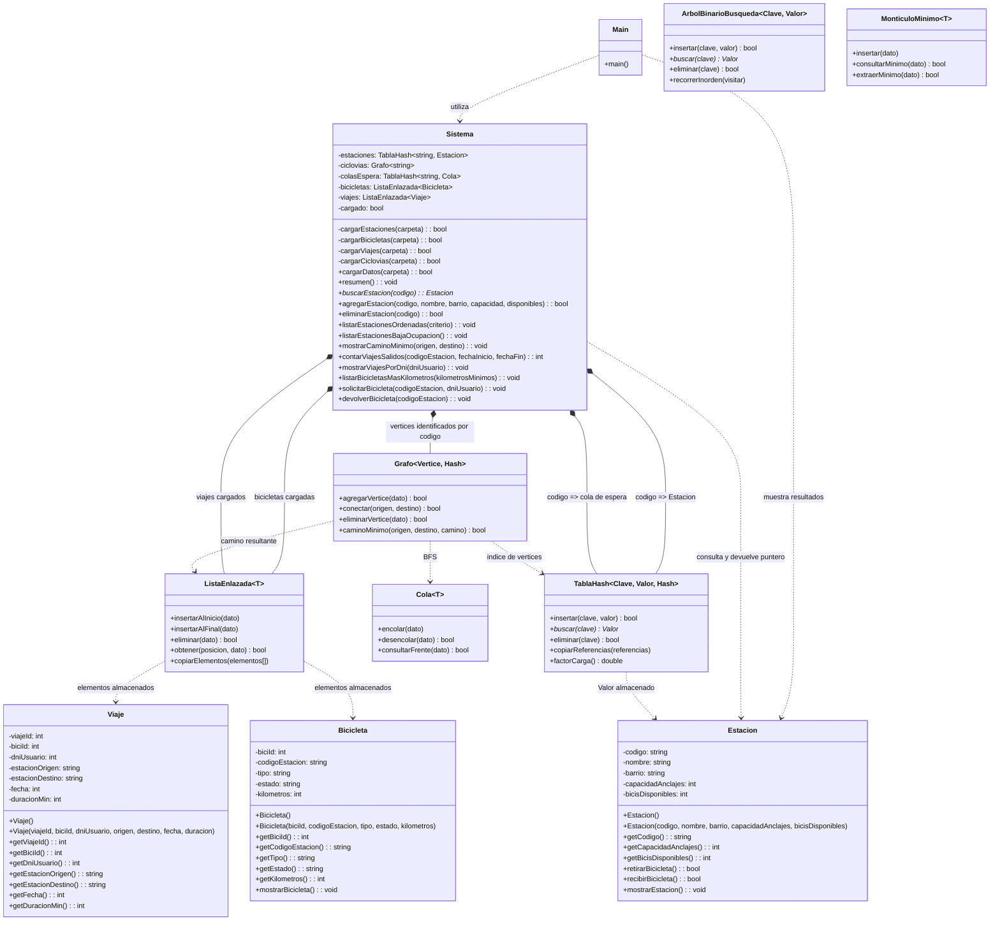

# UML actual — TP Integrador

Este diagrama describe las clases del TP y las estructuras reutilizables existentes al 12/11/2026. Muestra los tipos almacenados en las estructuras integradas y distingue las que todavía no usa `Sistema`.

## Lectura del diagrama

- `Main` representa la función libre `main()` de `src/main.cpp`; usa `Sistema` y muestra la estación obtenida.
- `Sistema` contiene una `TablaHash<string, Estacion>`: la clave es el código de estación (`string`) y cada valor es un objeto `Estacion`.
- `Sistema` mantiene un grafo genérico con los vértices de las estaciones y las conexiones bidireccionales de `ciclovias.txt`; usa BFS para mostrar el camino con menos tramos.
- `Grafo<string>` almacena los códigos de estación como vértices, no objetos `Estacion`.
- `Sistema` conserva los viajes de `viajes.txt` en una `ListaEnlazada<Viaje>`; B1 consulta el origen y la fecha para contar los viajes dentro del rango solicitado, y B2 los consulta por DNI y suma las duraciones.
- `Sistema` conserva las bicicletas de `bicicletas.txt` en una `ListaEnlazada<Bicicleta>`; B3 recorre la lista para mostrar las que superan el kilometraje ingresado.
- `Sistema` mantiene una cola FIFO por estación, indexada por código en una tabla hash. Al devolver una bicicleta, la entrega al primer DNI en espera; si no hay nadie esperando, aumenta la disponibilidad de la estación.
- La cola, el min-heap y el ABB están implementados en `estructuras/`, pero todavía no se integran al sistema.
- `Sistema` posee la tabla hash, el grafo y la lista; estas estructuras mantienen sus propios nodos y almacenan los tipos indicados en el diagrama.
