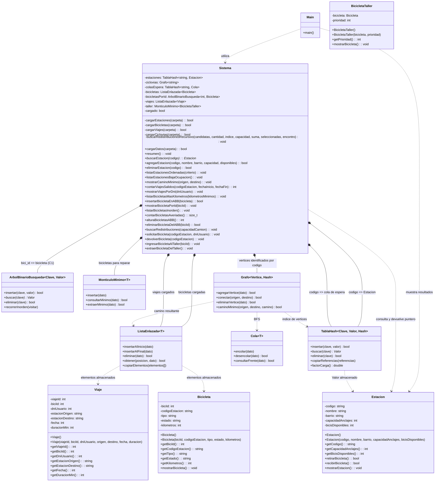

# UML actual — TP Integrador

Este diagrama describe las clases del TP y las estructuras reutilizables existentes al 15/11/2026. Muestra los tipos almacenados en las estructuras integradas y distingue las que todavía no usa `Sistema`.

## Lectura del diagrama

- `Main` representa la función libre `main()` de `src/main.cpp`; usa `Sistema` y muestra la estación obtenida.
- `Sistema` contiene una `TablaHash<string, Estacion>`: la clave es el código de estación (`string`) y cada valor es un objeto `Estacion`.
- `Sistema` mantiene un grafo genérico con los vértices de las estaciones y las conexiones bidireccionales de `ciclovias.txt`; usa BFS para mostrar el camino con menos tramos.
- `Grafo<string>` almacena los códigos de estación como vértices, no objetos `Estacion`.
- `Sistema` conserva los viajes de `viajes.txt` en una `ListaEnlazada<Viaje>`; B1 consulta el origen y la fecha para contar los viajes dentro del rango solicitado, y B2 los consulta por DNI y suma las duraciones.
- `Sistema` conserva las bicicletas de `bicicletas.txt` en una `ListaEnlazada<Bicicleta>`; B3 recorre la lista para mostrar las que superan el kilometraje ingresado.
- C1 inserta cada bicicleta cargada también en `ArbolBinarioBusqueda<int, Bicicleta>`, con `bici_id` como clave; el ABB rechaza identificadores duplicados. C2 busca por ese ID y muestra sus datos o informa si no existe; C3 recorre el ABB inorder para listarlas en orden creciente de ID; C4 cuenta las que tienen estado `Averiada` mediante un recorrido completo; C5 calcula la altura usando la operación del ABB; C6 opcional elimina del ABB por ID.
- `Sistema` mantiene una cola FIFO por estación, indexada por código en una tabla hash. Al devolver una bicicleta, la entrega al primer DNI en espera; si no hay nadie esperando, aumenta la disponibilidad de la estación.
- `Sistema` usa un `MonticuloMinimo<BicicletaTaller>` para B5; la prioridad acompaña a cada bicicleta y permite extraer primero la más urgente.
- La cola y el min-heap están integrados con el módulo B; el ABB genérico está implementado en `estructuras/` y C1–C6 lo integran con las bicicletas.
- D1 obtiene las estaciones de la tabla hash, calcula el faltante como capacidad de anclajes menos bicicletas disponibles y explora incluir o excluir cada estación candidata mediante backtracking.
- `Sistema` posee la tabla hash, el grafo y la lista; estas estructuras mantienen sus propios nodos y almacenan los tipos indicados en el diagrama.
